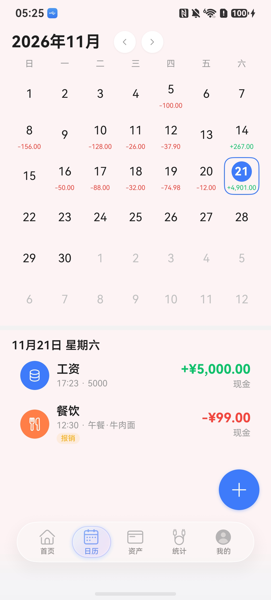
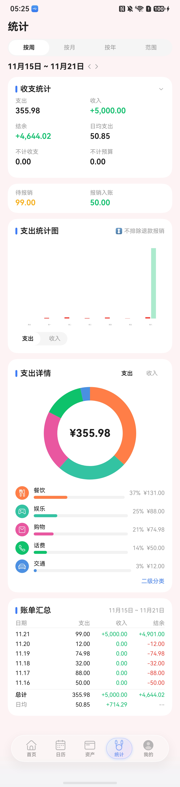
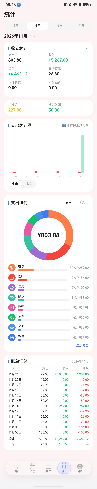
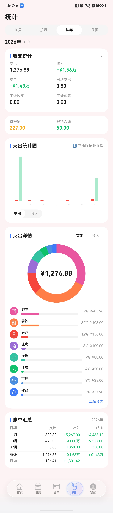
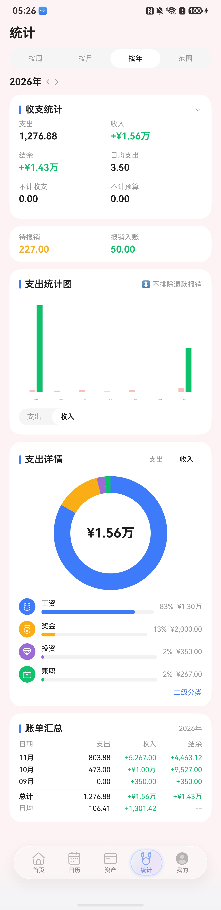
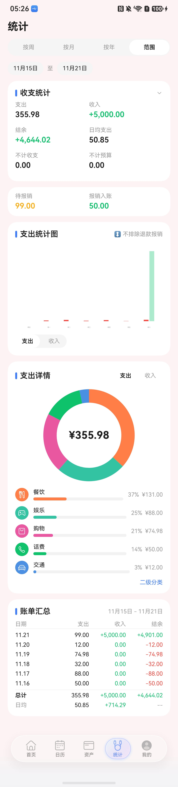
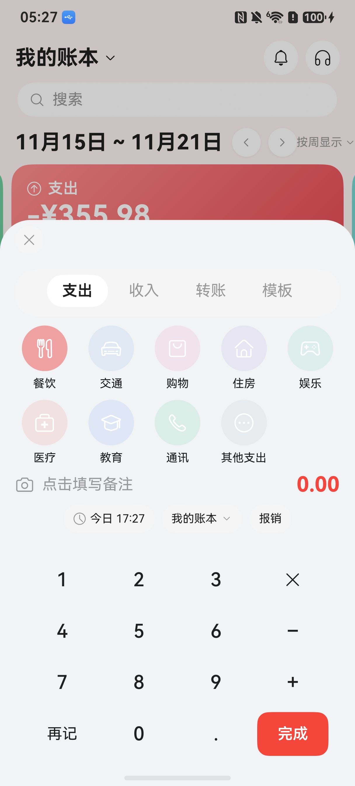
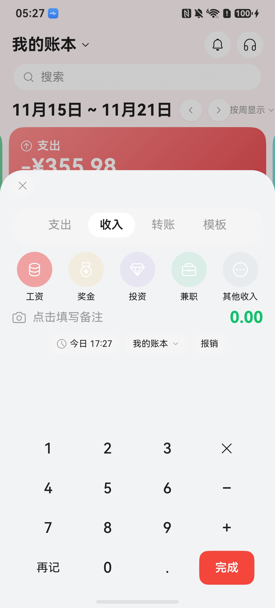

# 奇妙记账本（QiMiaoJiZhangBen）

基于 HarmonyOS ArkTS 的个人记账应用。

## 一、开发环境

| 项目 | 版本 |
| --- | --- |
| DevEco Studio | 26.0.0.461 |
| HarmonyOS SDK | 26.0.0（API 26，Beta1） |
| ArkTS / ArkUI | Stage 模型，状态管理 V2 |
| 测试环境 | DevEco Studio 模拟器（HarmonyOS API 26，1308×2880 @3.5x）+ HUAWEI Mate 60 真机 |

参考应用：考核方提供的"奇妙记账本"演示视频，本项目按其页面结构与交互完成复刻。

## 二、已实现功能（已完成内容）

- **账本首页**：账单列表按日期分组展示，支持按日 / 周 / 月切换统计周期
- **日历页**：月历视图展示每日收支，左右按钮切换月份，点选日期查看当日账单
- **资产页**：账户资产总览展示
- **统计页**：按周 / 月 / 年 / 范围的收支统计，Canvas 自绘图表
- **我的页**：个人中心及功能入口
- **记一笔**：底部弹层新增账单（金额键盘、分类选择），数据持久化至关系型数据库（RDB），金额以"分"为单位存储
- **悬浮 Tab 栏**：HdsTabs 液态玻璃悬浮栏 + 蓝紫色胶囊选中指示器（弹性跟随动画），内容穿透滚动
- **深浅色适配**：base / dark 双资源目录

## 三、应用截图

> 真机（HUAWEI Mate 60）实拍；长图为系统滚动长截屏。

### 首页 —— 汇总卡左右滑动切换（支出 / 收入 / 预算 / 结余）

| 支出卡 | 收入卡 | 预算卡 | 结余卡 | 显示模式菜单 |
| :---: | :---: | :---: | :---: | :---: |
|  |  |  |  |  |

### 日历 / 资产

| 日历 · 月视图 | 资产页 |
| :---: | :---: |
|  |  |

### 统计页 —— 按周 / 按月 / 按年（支出 · 收入）/ 范围

| 按周 | 按月 | 按年 | 按年 · 收入 | 范围 |
| :---: | :---: | :---: | :---: | :---: |
|  |  |  |  |  |

### 我的 / 记一笔（支出 · 收入 · 转账）

| 我的 | 记一笔 · 支出 | 记一笔 · 收入 | 记一笔 · 转账 |
| :---: | :---: | :---: | :---: |
|  |  |  |  |

## 四、导入编译运行步骤

1. 使用 DevEco Studio 打开项目根目录（含 `build-profile.json5`）
2. 等待 Sync 完成（自动安装 oh_modules 依赖）
3. 连接 HarmonyOS 设备或启动模拟器
4. 菜单 **File → Project Structure → Signing Configs** 配置自动签名
5. 点击 **Run**（或 `devecocli build` 后 `devecocli run`）编译安装运行

## 五、已知局限

- 未实现二级页面（账单详情、账户明细等页面跳转）
- 未实现账单编辑与删除（当前仅支持新增）

## 六、版权声明

本项目为个人学习 / 面试考核用途的仿写练习，与"奇妙记账"原应用及其开发方无任何关联，未使用其任何代码或美术素材。仅供学习交流，禁止商用，如有侵权请联系删除。
